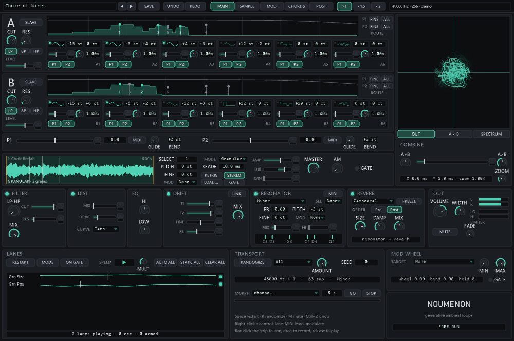
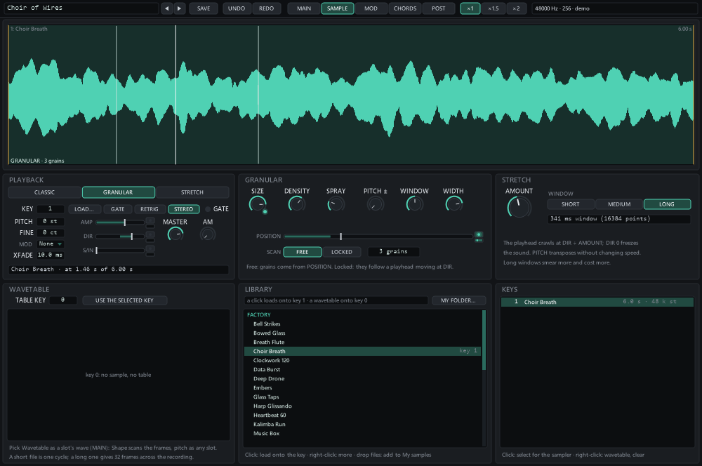

# Noumenon

A generative ambient loop instrument for 64-bit Windows. Two banks of six oscillators are summed
and ring-modulated, a looping sampler (or a live input) is mixed in, and a fixed effect chain turns
it into drones, pads and slowly moving textures — while the faders play themselves from loops you
record or roll at random. It sounds the moment it opens.

Noumenon is a **standalone application**, a **VST3 plugin** holding both **Noumenon** (an
instrument) and **Noumenon FX** (the same instrument as an effect, with an audio input), and
optionally the same two as **VST2** plugins. Written in C# on .NET 10.



---

## Download and install

Get **`Noumenon-<version>-Setup.exe`** from the
[Releases page](https://github.com/simasgg/Noumenon/releases).

1. **Close your music software.**
2. **Run the installer** and pick what you want:
   - **Standalone application** — plays on its own, with your audio interface and MIDI keyboard.
   - **VST3 plugin** — Noumenon and Noumenon FX in one module, for any VST3 host.
   - **VST2 plugins** (off by default) — only for hosts without VST3.
   - **Factory presets and samples** — always installed, shared by all of the above.
3. **Rescan plugins** in your host. In FL Studio: **Options → Manage plugins → Find installed
   plugins**. Noumenon appears with the instruments (generators), Noumenon FX with the effects.

The installer also installs the **Microsoft .NET 10 Desktop Runtime** if your PC doesn't have it
(and, with the VST2 plugins, the **Visual C++ runtime**). Both are inside it, so it needs no
internet connection.

> **"Windows protected your PC"** — the installer isn't code-signed yet, so SmartScreen may warn the
> first time. Click **More info → Run anyway**, or use the portable zips instead.

| What | Where it goes |
|---|---|
| Standalone, factory content, licences | `C:\Program Files\Noumenon` |
| VST3 plugin | `C:\Program Files\Common Files\VST3\Noumenon.vst3` |
| VST2 plugins (if chosen) | `C:\Program Files\Common Files\VST2\Noumenon` and `…\VST2\Noumenon FX` |
| Your presets | `Documents\Noumenon\Presets` (shared by every host) |
| Standalone settings, learned MIDI controllers | `%APPDATA%\Noumenon\settings.json` |

To remove it: **Settings → Apps → Noumenon → Uninstall**. Your own presets and recordings in
Documents are left alone.

**Portable zips** (`Noumenon-<version>-VST3-portable.zip`, `-VST2-portable.zip`,
`-Standalone-portable.zip`) hold the same files for a manual install; each carries its own copy of
the factory content. With them you install the .NET 10 Desktop Runtime (x64) yourself from
<https://dotnet.microsoft.com/download>, and for VST2 the
[Visual C++ v14 Redistributable (x64)](https://aka.ms/vc14/vc_redist.x64.exe), version 14.50 or newer.

### Requirements

| | |
|---|---|
| OS | 64-bit Windows 10 or 11 |
| Hosts | Any 64-bit VST3 host; VST2 for older hosts. 32-bit hosts are not supported. |
| Runtime | .NET 10 Desktop Runtime (x64) — **installed for you** |
| Channels | Instrument: stereo out. FX: stereo in → stereo out. A stereo sidechain feeds the envelope follower: an auxiliary bus on both VST3 plugins, inputs 3–4 of the VST2 FX. |

### Good to know

- **Use the VST3.** It carries both identities in one module and loads .NET once. The two VST2
  plugins each bring their own copy of VST.NET's bridge, and two such bridges in one process lock
  up — that includes another VST.NET plugin such as EmptySpace. If your host runs plugins in one
  process, use one VST2 identity at a time, or let the host bridge/sandbox them.
- **FL Studio sends no audio into instruments**, which is why Noumenon FX exists: put it on a
  mixer track to process the track (the FX family of presets is made for it).
- Noumenon reports a small constant **latency** (the distortion's oversampling filters, 63 samples at the normal engine rate) and hosts compensate it automatically.

---

## A tour of the panel

### The idea

Three things make Noumenon a loop generator rather than a synth:

1. **Faders that play themselves.** Fifty-six controls — levels, pitches, cutoffs, the combine
   fader, delay times, the sampler's direction — can carry a **lane**: a recorded or random loop
   that plays instead of the fader. Lanes have their own lengths, so they drift in and out of phase
   and the patch never quite repeats.
2. **Two pitch faders, P1 and P2.** Every oscillator slot adds the P faders it is routed to. A P
   fader can follow MIDI, glide, and carry a lane of its own — recording a P fader is recording a
   melody.
3. **A transport for the loops**: restart them all, change their speed, randomize everything, or
   glide to another preset.

The panel has five pages — **MAIN**, **SAMPLE**, **MOD**, **CHORDS**, **POST** — and a top bar with
the preset menu (◀ ▶ step through it), **SAVE**, **UNDO**/**REDO**, the page buttons, the panel
size (**×1 / ×1.5 / ×2**) and a status line.

### MAIN — the signal as it flows

**Sections A and B** (the two strips at the top). Each has six oscillator slots. A slot has a wave
(click the icon: sine, triangle, saw, square, pulse, bipolar pulse, two noises, *Wavetable*, *Sub*),
a semitone and a fine tuning, a level bar and a knob for **Shape** (pulse width, triangle lean,
wavetable position, the sub's balance) or the noise's cutoff, a trim, and two buttons, **P1** and
**P2**: whether that slot follows each pitch fader. On the left of the strip: the section's 12 dB
filter (**CUT**, **RES**, **LP/BP/HP**, **SLAVE** to the master filter's cutoff) and its
**LEVEL**. The display across each strip is the section's live spectrum with its filter curve and a
mark for every oscillator — drag a mark sideways to retune that slot, up or down for its level. On the right, **ROUTE** sets
**ALL** (route every slot of the section to the fader) and **FINE** (the fader moves those slots
in cents instead of semitones).

**P1 and P2** (the strip below). The fader value in semitones, **MIDI** (follow the last note
played, plus pitch bend times **BEND**), and **GLIDE**.

> **Tip — MIDI on one P fader or on both?** By default every slot is routed to both faders, so
> switching MIDI on for **P1** alone makes all the oscillators follow your keys in tune. Turn MIDI
> on for **P2** as well and a slot routed to both moves twice as far. P2 earns its MIDI button
> once the routing splits the work: turn off the P2 buttons of one section and the P1 buttons of
> the other, and the two sections follow the keyboard with their own glide and bend; and the
> sampler's **MOD** listens to P2 by default, so P2 is how a sample follows the keys.

**The sample strip** — the sampler as MAIN shows it: the map key it plays (**SELECT**), **PITCH**,
**FINE**, **MOD** (which P fader transposes it), the playback **MODE**, the loop crossfade, **AMP**,
**DIR** (speed and direction: negative plays backwards, 0 holds still), **S/IN** (the crossfade
from the sample to the live input), **MASTER**, the **AM** route (the sample's envelope shapes the
oscillators), **RETRIG**, **STEREO**. Drop an audio file on the display, double-click it to load
one, or right-click it → **Factory sample** for the bank that ships with Noumenon.

**The display and COMBINE.** The display shows the output as an XY scope (drag it to offset the
phase of X and Y and turn the figure; **ZOOM** is its gain), section A against section B, or the
output spectrum. **COMBINE** is where the sections meet: **A+B** balances the sum, **A×B** sets the
ring modulation's level, and the fader between them crossfades from the sum to the ring.

**The chain**, left to right as the signal goes: **FILTER** (low-pass to notch to high-pass,
**CUT**, **RES**, **MIX**), **DIST** (tanh, fold-back or bit reduction, at twice the rate), **EQ**
(two shelves), **DRIFT** (a through-delay: **T1** left, **T2** right, **FINE**, **FB**; moving the
times bends the pitch of everything passing through, which is the point), **RESONATOR** (six tuned
combs ringing a chord: the chord list or **Voices**, **FB** knob plus fader, **PITCH**/**FINE**,
**MOD**, **MIX**, **MIDI** to play the voices from a keyboard), **REVERB** (six rooms, **FREEZE**,
**SIZE**, **DAMP**, **MIX**; **ORDER** puts it before or after the resonator), and **OUT**
(**VOLUME**, **WIDTH**, the mute's **FADE**, the meters).

**LANES** — the loops. **RESTART** sends every lane back to its start (also the space bar),
**MODE** restarts them whenever a recording starts or ends, **ON GATE** restarts them on every MIDI
note, the arrows and **MULT** set their speed, and **AUTO ALL / STATIC ALL / CLEAR ALL** act on every
lane at once. The overview shows each loop as a line with its playhead.

**Recording a lane** — on any fader with a lane strip under it:

1. **Click the strip** under the fader: it arms (it blinks).
2. **Drag the fader**: everything you do is recorded, and the strip fills while it records.
3. **Let go**: the loop is stored and the lane stays armed — drag again to record a new take.
4. **Click the small button** beside the strip to switch between the loop (lit: *Automated*) and
   the plain fader (*Static*). The strip then shows where the loop is playing.

Any control's **right-click** menu has the same lane actions, plus **Learn MIDI CC**, **Modulate
with …** (into the first free matrix slot) and **Reset to default**.

**TRANSPORT.** **RANDOMIZE** (also the R key) rolls a new patch from a seed — the scope menu
limits it to the oscillators, the sampler, the effects or the lanes, **AMOUNT** keeps it closer to
a tonal drone, and a number in **SEED** makes it repeatable. **MORPH** glides every parameter to
another preset over the time beside it; lanes and samples stay.

**MOD WHEEL** — the wheel moves one control of your choice between **MIN** and **MAX**.

### SAMPLE — the sampler in depth



The sample display (loop handles, the grains or the stretch window drawn on it), **PLAYBACK** with
the three modes — **Classic** (a loop that crossfades its seam), **Granular** (up to 32 windowed
grains: **SIZE**, **DENSITY**, **SPRAY**, **PITCH ±**, **WINDOW**, **WIDTH**, **POSITION**, and
**SCAN** free or locked to a playhead moving at DIR) and **Stretch** (spectral time-stretch:
**AMOUNT** slows it without changing pitch, three window lengths) — the **WAVETABLE** view of the
sample the oscillators' Wavetable wave reads, and **KEYS**, every loaded sample.

### MOD — the modulation matrix

Three **LFOs** (sine to drift) and the **envelope follower** (which signal it hears: the sampler,
the input, the sidechain, the sections or the output), each with a live trace; four **MACROS**;
twelve matrix slots — source, target, depth, and a bar showing what the slot adds right now;
**MIDI**: the matrix's CC and the controllers you have taught it; **HOST SYNC** (lanes snap to bars,
sequencer steps to beats), **RESTART ON PLAY** and the **ENGINE RATE** (2× runs the engine at
twice the host rate).

### CHORDS — the resonator's harmony

The six resonator **VOICES** (note, feedback, damping, level, pan), the **CHORD** list and the
**SELECT** input (keys from C#3 up pick chords 1, 2, 3 …), eight user chord memories (store what is
ringing now, or fill them with the chords of the current key), the **SCALE** and tuning (the standalone loads
a Scala `.scl` file as the user scale), the **PLAY MODE** (*Free-run* drones on, *Gated* opens on a note
and closes on release, with **ATTACK** and **RELEASE**) and the **CHORD SEQUENCER**: up to eight
steps, each a degree of the scale, stepping at **STEP TIME** with the lanes' clock, its chord
replacing the resonator's, its root optionally driving P1 or P2.

### POST — after everything

A second filter and EQ and a two-band limiter (**LOW**/**HIGH** thresholds, **SPLIT**, **GAIN**,
release speed) for taming the result without changing what feeds the resonator, then the post
volume.

### Keys

| Key | |
|---|---|
| Space | Restart the lanes |
| R | Randomize |
| M | Mute (with the OUT fade) |
| Ctrl+Z / Ctrl+Y | Undo / redo (one step per gesture) |
| Ctrl+Tab | Next page |
| Mouse wheel | Step a control; double-click: its default; right-click: its menu |

---

## The factory bank

Fifty presets in six families, all levelled to the same loudness (−20 LUFS) so changing presets
doesn't jump in volume. Each has a short description.

| Family | What it is for |
|---|---|
| **Drone** | Patches that play themselves: slow lanes on levels, cutoffs and pitches, never quite repeating. |
| **Pad** | For a keyboard: gated pads with slow envelopes, chords picked by the keys, the chord sequencer. |
| **Texture** | The factory samples up front — granulated, stretched, ringing through the resonator. |
| **Rhythmic** | Pulse from the 120 BPM loops, the AM route, square LFOs, sequenced chords; with Host Sync they follow your tempo. |
| **Broken** | Distortion, bit reduction, ring modulation, stepped pitch lanes, feedback near its edge. |
| **FX** | For **Noumenon FX**: whatever you feed in runs through the resonator, the drift delay, the distortion and the reverb — or shapes a drone through the envelope follower. |

The **factory samples** are original, synthesized for Noumenon — sustained tones (bowed glass, a
breathy choir, tape strings, a reed organ, a flute, a low drone), plucks and bells, field-like
textures (wind, rain, surf, embers, tape hiss, shortwave, night insects, vinyl), two 120 BPM loops
and a heartbeat, and digital debris — plus five wavetables (a harmonic ladder, vowels, pulse widths, odd glass,
organ stops) for the oscillators' Wavetable wave. A preset that uses one stores it as
`factory:samples/…`, so it loads in every host.

**How the bank is made.** The presets are recipes in code (`Noumenon.Factory/Bank`), written like
patch sheets — slots, sections, chain, lanes — so the bank is reproducible and every value is
deliberate. Each lane comes from the recipe's own seed. Every preset is then played offline for
half a minute — with notes if it is gated, with audio if it is an FX preset — measured, and its
Output Volume set to the common loudness. The samples are rendered by the same tool.

---

## The standalone

**Audio** settings pick WASAPI (shared or exclusive) or ASIO, the sample rate and buffer, an input
for Samp↔In and a MIDI port; without a MIDI keyboard the computer keyboard can play notes. The
toolbar records the output to WAV, plays an internal transport for Host Sync, and has a *party mode*
that randomizes on a timer. **File → Bounce** renders a preset offline to WAV, faster than real
time. **View → Developer Panel** lists every parameter with its lane buttons.

From the command line (`Noumenon.Standalone.exe` in the install folder):

```
Noumenon.Standalone.exe --preset "Basalt"
Noumenon.Standalone.exe --bounce out.wav --minutes 20 --rate 48000 --preset "Drone/Living Faders"
Noumenon.Standalone.exe --record live.wav --seconds 600
```

---

## Building from source

Requires the **.NET 10 SDK**. The Windows projects are **x64-only**, so pass `-p:Platform=x64`.

```
dotnet build Noumenon.slnx -p:Platform=x64                       # everything, Debug
dotnet test Noumenon.Tests/Noumenon.Tests.csproj                  # the engine
dotnet test Noumenon.Vst2.Tests/Noumenon.Vst2.Tests.csproj -p:Platform=x64
dotnet test Noumenon.Vst3.Tests/Noumenon.Vst3.Tests.csproj -p:Platform=x64   # incl. Steinberg's validator

dotnet run --project Noumenon.Standalone -p:Platform=x64          # the standalone
dotnet run --project Noumenon.TestHarness -- --preset "Basalt" --seconds 30 --out basalt.wav

powershell -ExecutionPolicy Bypass -File tools\Test-PluginLoad.ps1   # load the plugins like a host, no DAW

dotnet run --project Noumenon.Factory -p:Platform=x64 -- samples   # re-render the factory samples
dotnet run --project Noumenon.Factory -p:Platform=x64 -- presets   # rebuild and level the factory bank
dotnet run --project Noumenon.Factory -p:Platform=x64 -- artwork   # the icon and installer images
```

The plugins a host loads are laid out by the build:

| | |
|---|---|
| VST3 (both identities) | `Noumenon.Vst3\bin\x64\<cfg>\net10.0-windows\deploy\Noumenon.vst3` |
| VST2 Noumenon | `Noumenon.Vst2\bin\x64\<cfg>\net10.0-windows\deploy` |
| VST2 Noumenon FX | `Noumenon.Vst2.Fx\bin\x64\<cfg>\net10.0-windows\deploy` |

**Release artifacts**: `.\build-release.ps1` builds x64 Release, runs the tests and the native load
test, caches the two Microsoft redistributables in `installer\redist`, compiles
`installer\Noumenon.iss` with [Inno Setup 6](https://jrsoftware.org/isinfo.php)
(`winget install --id JRSoftware.InnoSetup -e`) and writes the installer, the portable zips and the
release notes into `dist\`. `-TestInstall` also installs the result into a sandbox folder, loads the
installed plugins and uninstalls it again; `-NoVst2` leaves the VST2 plugins out; `-SignCommand`
signs the binaries and the installer. The version is set once, in `Directory.Build.props`;
`CHANGELOG.md` holds the notes for each version.

| Project | |
|---|---|
| `Noumenon.Dsp` | The DSP: oscillators, filters, sampler (granular, stretch), effects, reverb. No host or UI code. |
| `Noumenon.Engine` | The parameter table, the engine, lanes, modulation, presets, samples, recording. |
| `Noumenon.Ui` | The owner-drawn editor shared by every host. |
| `Noumenon.Standalone` | The NAudio host application. |
| `Noumenon.Vst2`, `Noumenon.Vst2.Fx` | The VST2 plugins (VST.NET). |
| `Noumenon.Vst3` | The VST3 module with both identities (NPlug). |
| `Noumenon.Factory` | Builds the factory content: samples, presets, artwork. |
| `Noumenon.TestHarness` | Renders the engine to WAV from the command line. |
| `Noumenon.Tests`, `Noumenon.Vst2.Tests`, `Noumenon.Vst3.Tests` | The tests. |

---

## Credits

- Inspired by **Metaphysical Function** (Native Instruments, Reaktor, 2004 — Mike Daliot and
  Phirol) and its 2016 extension **Metaphysical Fabrications** (contortDistort). Noumenon is an
  independent implementation: no Reaktor code, samples, snapshots, names or artwork are used.
- The reverb engines come from **EmptySpace**, its sibling plugin.
- [**VST.NET 2**](https://github.com/obiwanjacobi/vst.net) by Jacobi Software — the VST2 plugins.
- [**NPlug**](https://github.com/xoofx/NPlug) by Alexandre Mutel — the VST3 plugin.
- [**NAudio**](https://github.com/naudio/NAudio) by Mark Heath — audio devices, MIDI, file decoding.
- The **VST 3 SDK** by Steinberg Media Technologies (MIT licence since 3.8), whose interfaces NPlug implements.
- [**Inno Setup**](https://jrsoftware.org/isinfo.php) by Jordan Russell and Martijn Laan — the installer.

The licence texts of everything Noumenon ships with are in `installer/licenses` (installed to
`C:\Program Files\Noumenon\Licenses`). VST is a registered trademark of Steinberg Media
Technologies GmbH.
